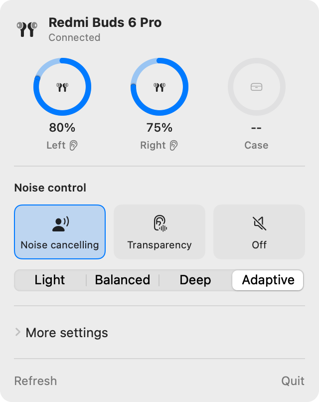
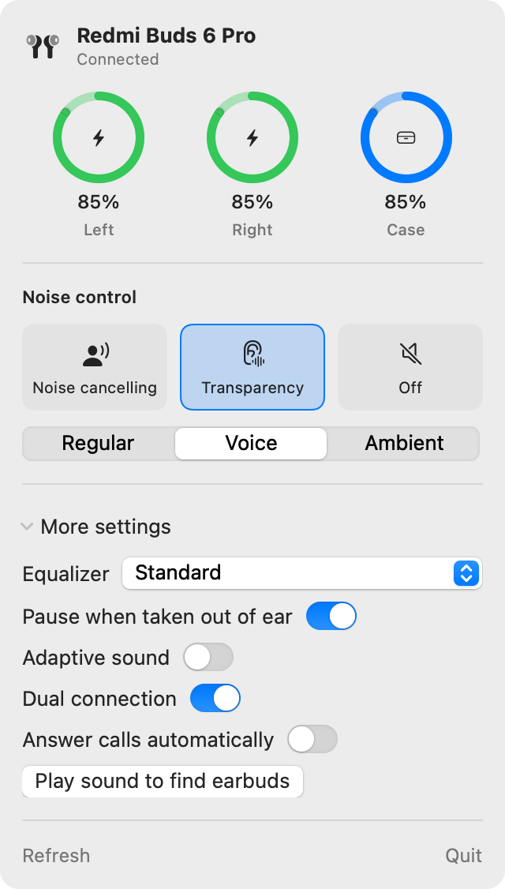

# Redmi Buds for macOS

Menu bar app (SwiftUI + IOBluetooth) for the Redmi Buds 6 Pro: battery (left, right, case) and noise control (noise cancelling / transparency / off), plus ANC strength, transparency modes, equalizer, ear detection, adaptive sound, dual connection, auto-answer and "play sound to find".

<p align="center">
  <picture>
    <source media="(prefers-color-scheme: dark)" srcset="docs/screenshots/menu-dark.png">
    
  </picture>
  &nbsp;&nbsp;
  <picture>
    <source media="(prefers-color-scheme: dark)" srcset="docs/screenshots/settings-dark.png">
    
  </picture>
</p>

The menu follows the macOS language (English, Spanish, French and Brazilian Portuguese) and light/dark appearance. Screenshots are generated by the app itself with `--ui-snapshot` (see below).

## Tested with

| Earbuds | Firmware | Mac | macOS |
| --- | --- | --- | --- |
| Redmi Buds 6 Pro | 1.3.7.3 | MacBook Pro (MacBookPro18,1, Apple silicon) | 27.0.1 |

Other Redmi Buds that Gadgetbridge drives with the same protocol (3 Pro, 4 Active, 5 Pro, 6, 6 Active, 6 Lite, 8 Active) will probably connect, since the app matches any paired device named "Redmi Buds…", but they are untested and their features differ.

## Install

1. Download `RedmiBuds-<version>-macOS.zip` from the [latest release](https://github.com/luizchaos/xiaomi-buds-app-mac/releases/latest), unzip it and move **Redmi Buds.app** to Applications.
2. Open the app. macOS blocks the first launch because the app is **not notarized by Apple**: it is only ad-hoc signed, since signing and notarizing require a paid Apple Developer Program membership (Developer ID). To allow it, either:
   - go to **System Settings › Privacy & Security** and click **Open Anyway** next to the message about Redmi Buds, then confirm; or
   - remove the quarantine flag in Terminal:
     ```bash
     xattr -dr com.apple.quarantine "/Applications/Redmi Buds.app"
     ```
   This is needed only once. You can also build the app yourself from source (below), in which case no warning appears.
3. Allow Bluetooth access when asked.

Requires macOS 14 or later. Universal binary (Apple silicon and Intel).

## Build

```bash
./scripts/build-app.sh          # produces "build/Redmi Buds.app"
open "build/Redmi Buds.app"
swift test                      # protocol tests (BudsKit)
```

Command-line mode (for debugging and the Shortcuts app):

```bash
open -n -W -o /dev/stdout "build/Redmi Buds.app" --args --cli status -v
# commands: status | anc | transparency | off | anc-light | anc-balanced | anc-deep | anc-adaptive
#           find | stop-find | eq <standard|voice|bass|treble|custom>
```

UI self-check: opens the popover, expands and collapses "More settings", reopens it, and saves a PNG and the window size for each step (no screen-recording permission needed):

```bash
open -n -o /dev/stdout "build/Redmi Buds.app" --args --ui-snapshot /tmp/redmibuds-snapshots
# README screenshots: add --appearance light|dark -AppleLanguages "(en)"
# and copy 1-opened.png / 2-expanded.png to docs/screenshots/
```

The menu uses `NSStatusItem` + `NSPopover` rather than SwiftUI's `MenuBarExtra(.window)`, whose panel never shrinks back after its content gets smaller.

## Layout

- `Sources/BudsKit/Frame.swift`: `FE DC BA … EF` frame format and stream reassembly
- `Sources/BudsKit/Auth.swift`: challenge/response (SAFER+ variant) required by the earbuds
- `Sources/BudsKit/BudsSession.swift`: protocol state machine, no I/O (unit tested)
- `Sources/BudsKit/BudsController.swift`: IOBluetooth (SDP, RFCOMM, connect/disconnect notifications)
- `Sources/RedmiBuds/`: menu bar app (NSStatusItem + NSPopover hosting SwiftUI), `--cli` mode and localized labels
- `Resources/Localization/<language>.lproj/`: UI strings

## Localization

The app follows the macOS language setting. It ships in English (base language, also the fallback), Spanish (`es`), French (`fr`) and Brazilian Portuguese (`pt-BR`). The `es` and `fr` folders cover every regional variant (e.g. `es-MX`, `fr-CA`); add a regional folder only if a variant needs different wording.

To add a language, e.g. Spanish:

1. Copy `Resources/Localization/en.lproj` to `Resources/Localization/es.lproj`.
2. Translate the values (never the keys) in `Localizable.strings` and `InfoPlist.strings`.
3. Run `./scripts/check-localizations.sh` to confirm every key is present.
4. Rebuild. The build script registers every `.lproj` folder in `CFBundleLocalizations` automatically.

In code, SwiftUI views take keys directly (`Text("noise.title")`); non-view code uses `String(localized: "…")` (see `Sources/RedmiBuds/Localization.swift`). The check script also fails if code uses a key missing from English.

## Protocol

Control goes over an RFCOMM channel with service UUID `0xFD2D` (on the 6 Pro, the "miwear" SDP record, channel 24). The reverse engineering comes from [Gadgetbridge](https://codeberg.org/Freeyourgadget/Gadgetbridge); this project reimplements the protocol in Swift, and the authentication code is ported from it.

## Status

On the Redmi Buds 6 Pro (see [Tested with](#tested-with)), authentication, battery, in-ear detection and mode switching (noise cancelling, transparency, off, strength, adaptive) work.

- The earbuds accept only **one** control connection. If a phone is connected with the Xiaomi Earbuds app open, the channel is rejected (`bluetoothd` error 913).
- With both earbuds in the ear, the case battery came back as "unavailable" (`0xFF`). It is probably only reported while an earbud is in the case (not verified).
- The 6 Pro sometimes reports ANC strengths outside the 5 Pro table (e.g. `0x07`, `0x0B`), probably from its 20-level scale. They are ignored for now.
- Not yet tested on the device: case battery, equalizer, the toggles under "More settings" and "play sound to find".

## License

[GNU Affero General Public License v3.0 or later](LICENSE.md) (`AGPL-3.0-or-later`).

The protocol and authentication code derive from [Gadgetbridge](https://codeberg.org/Freeyourgadget/Gadgetbridge), which is AGPL-3.0, so this project uses the same license. You may use, modify and redistribute it, but distributed versions (including modified ones) must stay under the AGPL and ship their source code.

Not affiliated with or endorsed by Xiaomi. "Redmi" and "Xiaomi" are trademarks of their respective owners.
